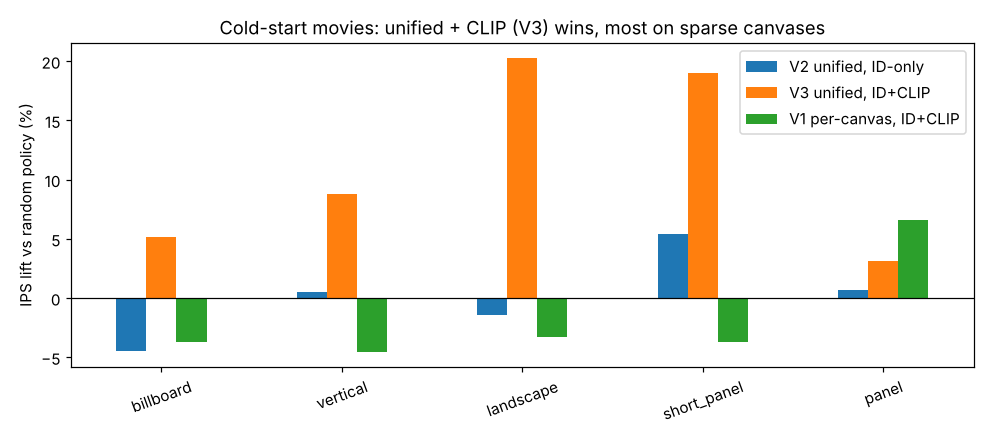
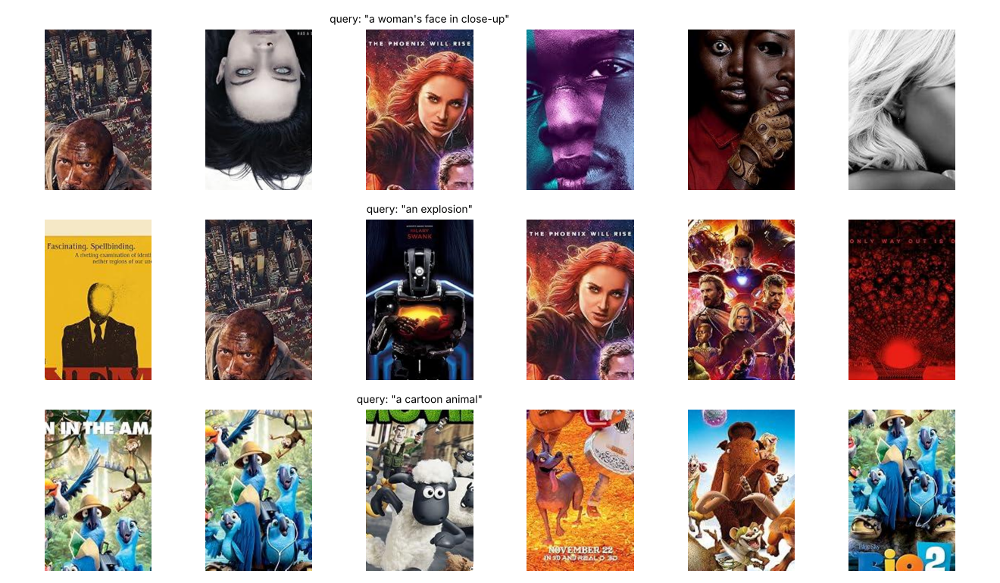

# Netflix fixed cold-start with two ideas. Either one alone does nothing.

## I rebuilt Netflix's artwork personalization on MovieLens to see what really drives it.

*Part 1 of Netflix Tech Blog, rebuilt. [Part 2: the billboard bandit](https://medium.com/@faycal.zouine.usa/i-rebuilt-netflixs-billboard-bandit-the-metric-picked-the-winner-686296a3b72f) · [Part 3: what recommendations are worth](https://medium.com/@faycal.zouine.usa/your-dashboard-says-recommendations-multiply-viewing-by-7-5-the-truth-is-3-1-a7b68e8334c3)*

Every new title on Netflix arrives with artwork nobody has clicked on yet. For a model that learns from clicks, that artwork is a blank. Netflix's older artwork models made it worse by treating each image as an ID number, so the model never actually looked at the picture.

In August, Netflix published [MAPS](https://netflixtechblog.com/maps-netflixs-multimodal-asset-personalization-at-scale-32f96320785e), the system that replaced them. It rests on two ideas. The first is to run every image through CLIP, a model that turns a picture into a set of numbers describing what is in it, and to give those numbers to the ranking model, so a new image arrives with something the model already understands. The second is to replace five separate models, one for each shape of artwork on the page, with a single shared one. Netflix tested each idea on its own and both together, and only the combination improved their live metrics. I wanted to see whether that result would hold when I rebuilt it on public data.

## The setup

MovieLens gives about 890,000 real ratings along with movie posters. I cut each poster into four crops to stand in for alternative artworks, rendered each crop in Netflix's five shapes, and ran everything through CLIP, which gave me 11,060 images for 553 movies. I held out 20% of the movies entirely so I could test on titles the model had never seen.

The clicks had to be simulated, because no public dataset logs artwork impressions. My simulated members' tastes are built from CLIP and the winning model uses CLIP, which tilts the setup in its favor. So this rebuild can show how the mechanism works, but not how big the effect would be at Netflix.

## The first run failed

Every model scored the same as random guessing, including the ones with CLIP. It took me a while to find out why. CLIP vectors all point in roughly the same direction, so even two unrelated movies had a similarity of 0.28 instead of something near zero. In practice, all four crops of a poster looked about equally appealing to every member, and there was nothing to personalize. Subtracting the average vector before comparing them fixed it. After that, a member's favorite crop had about a 0.20 chance of being clicked and their least favorite about 0.06. If you use CLIP similarities anywhere, this is worth checking first.

## Only the combination worked

I rebuilt the three versions Netflix compared: five separate models with CLIP, one shared model without CLIP, and one shared model with CLIP. On movies the models had never seen, the first two moved between −5% and +7% compared to random, which is noise. The shared model with CLIP improved on all five shapes, by 5% on the billboard, 9% on vertical, 20% on landscape, 19% on short panel and 3% on panel.

The reason both ideas are needed makes sense once you see it. CLIP tells the model what is in an image, but a shape that is rarely shown doesn't get enough clicks for its own model to learn what to do with that information. A shared model learns it from the busy shapes and applies it to the quiet ones. On their own, neither idea has what it needs.

## Two smaller ideas worth stealing

The way Netflix evaluates these models offline is worth knowing on its own. A small slice of traffic gets random artwork, and the system records the probability of each choice at the moment it is made. Reweighting results by those probabilities gives a fair estimate of how a new model would have done, without running an A/B test. It is the same reasoning as the geo lift tests I ran on the agency side: a small, deliberate amount of randomness buys a clean comparison.

The second is a cheap check before an expensive test. Before integrating a new image model, Netflix asks whether a simple linear model using only the image numbers can predict which artwork wins. In my rebuild it picked the winner 35.5% of the time against 25% for chance, which is modest but clearly above it. And because CLIP reads text as well as images, the same numbers make search-aware artwork almost free. Searching for "an explosion" brings up artwork with explosions in it.

## What I take from it

The main lesson isn't about images. Two changes that each look useless in a test can be exactly what is needed together, which is a good reason to test combinations before dropping a feature. Netflix's newer work adds audio and captions to the image signal. There is no public data like it, so my rebuild stops at posters.

---

*Notebook and code: [github.com/ZFayFay/netflix-maps-replication](https://github.com/ZFayFay/netflix-maps-replication). All ideas belong to the Netflix authors. This is an independent rebuild of their [MAPS post](https://netflixtechblog.com/maps-netflixs-multimodal-asset-personalization-at-scale-32f96320785e).*
